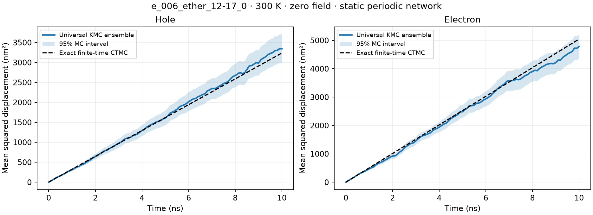

# cube — 有机分子载流子输运计算软件

cube 面向有机分子晶体、非晶和聚合物的载流子输运研究。当前可用功能包括四语言通用 KMC、速率函数、真实体系验证，以及可选的 CPU/GPU 转移积分、vacuum 与冻结 MM 静电嵌入四点法重组能；完整材料输运工作流仍在建设。Python 分发名仍为 `universal-kmc`，KMC 命令为 `ukmc`，独立量化命令为 `cube-transfer`。

[软件调研与证据](docs/research/README.md) · [输运理论契约](docs/research/transport-theory.md) · [cube 架构与实施路线](docs/plans/2026-11-05-cube-carrier-transport-design.md)

## cube input 统一入口

提供可执行脚本 `cube`，默认读取 `$get_dimers_monomers/$one-mol/$two-mol/$reorganization-energy ... $end` 格式的 `input`。支持 GROMACS 轨迹按起始帧/帧间隔提取单体、core 距离 dimer 和完整冻结 MM 簇、按 `format` 选择 XYZ/GJF、CPU/GPU 单体与 dimer 量化、DIPRO，以及 vacuum / 冻结 MM 静电嵌入四点法。原始数据路径已填入仓库根目录 `input`，可直接先做预检/提取：

```bash
uv sync --locked --extra workflow
./cube input --plan
./cube input --only get_dimers_monomers
```

[控制文件与所有字段说明](docs/cube-input.md)。实际 anneal_a 最后一帧已提取 100 个完整分子和 550 个 dimer，并与参考脚本逐项一致。`--resume` 复用选定且已实现阶段的一致成功结果；GPU 引擎需要安装 `quantum-cuda13` 可选依赖。

新增 `$charge-carrier/$exciton` 的 `do=0/1` 开关及预检；迁移率和激子求解尚未接通 `cube input`，启用时会在计算前明确报错。根 `input` 按用户设置载流子为 1、激子为 0；继续量化可用 `./cube input --only one-mol --only two-mol --only reorganization-energy --resume`，详见[开关说明](docs/cube-input.md#迁移率与激子开关)。

新增 `frame_step` 多帧提取和 `monomers-qmmm-cutoff` 单体环境簇，支持后续量化逐帧调度；真实轨迹 1980/2000 帧及断点续算结果见[多帧提取验证](runs/frame_extraction_2026-11-08/README.md)。

GRO 三维簇查看器已迁至独立项目 [cube-view](https://github.com/Tiny-Cube/cube-view)，实现、uv 环境、测试和发布均在新仓库维护。查看器使用 `uv run cube-view structure.gro --cutoff 6 --open`，不依赖本项目。

`cube input` 的小分子流程已在 RTX 5090 通过 CPU/GPU 对照，包括 DIPRO、GPU 梯度优化、vacuum 四点重组能及断点续算，见 [GPU 工作流实测](runs/cube_input_gpu_2026-11-07/README.md)。实际 MD 的全部量化任务尚未运行。

新增冻结 MM 的 QM/MM 四点法：环境坐标、电荷固定，只优化 QM 分子；可从 GROMACS 帧自动选取完整邻近分子，或读取外部点电荷文件。CPU/GPU 优化、梯度、四点能量及续算已实测，见 [原静电模型验证](runs/qmmm_frozen_mm_2026-11-07/README.md)。现在另支持原 TPR 的 QM–MM LJ12-6 排斥/色散，根目录 `input` 已启用；见[范德华参数与异机导出](docs/cube-input.md#加入原力场的-qmmm-范德华作用)。未包含可极化 MM。

独立的 G16/GPU 同模型比较工具已完成小体系能量、梯度和完整四点法数值预检；2026-11-08 的真实 6 Å 材料计时提交时处于等待旧 CPU 任务的队列中，尚无加速倍数，见[对比范围与验证记录](runs/g16_gpu_qmmm_6A_2026-11-08/README.md)。

## 新增：GPU 转移积分

[理论公式、原始论文与使用方法](docs/transfer-integrals.md) · [RTX 5090 实测](runs/transfer_gpu_2026-11-06/README.md)

提供收敛二聚体投影 DIPRO、中性 frozen-density 近似、受适用性检查约束的 ESID，以及明确标注单电子近似的 orbital GMH。支持空穴/电子与多轨道耦合块；SCF 失败不会输出伪有效参数。代码注释引用各方法原论文。量化依赖可选，通用 KMC 仍可独立安装。

支持你指定的两阶段流程：**单体/dimer XYZ → 独立 PySCF 脚本 → `.chk` 输出 → TOML 控制文件与独立转移积分脚本 → JSON**。详见[完整使用说明](docs/pyscf-transfer-workflow.md)。CPU 示例：

```bash
uv run --locked --extra quantum python scripts/run_pyscf.py \
  examples/quantum/ethylene_a.xyz examples/quantum/ethylene_b.xyz \
  examples/quantum/ethylene_ab.xyz --output-dir examples/quantum/results
uv run --locked --extra quantum python scripts/calculate_transfer.py examples/quantum/transfer.toml
```

第二阶段只读取已有结果，不重新运行 SCF。两阶段可分别选择 CPU/GPU，控制文件指定三份 checkpoint、计算方法、载流子和输出路径。标准 `.log` 通常没有完整轨道矩阵，不能替代 `.chk`。

原有 XYZ 直接计算命令仍可使用：

```bash
uv sync --locked --extra quantum-cuda13
uv run --locked --extra quantum-cuda13 cube-transfer \
  --fragment-a examples/quantum/ethylene_a.xyz \
  --fragment-b examples/quantum/ethylene_b.xyz \
  --backend gpu --basis def2-svp --xc b3lyp \
  --method dipro --method frozen_density --output build/transfer.json
```

CPU 使用 `--extra quantum` 和 `--backend cpu`。GPU 量化适配器不等于已经实现 GPU KMC；QM/MM 重组能使用 `cube input`，详见[冻结 MM 控制说明](docs/cube-input.md#冻结-mm-的-qmmm-四点法)。独立转移积分仍使用真空模型。

## 当前基础：通用 KMC

四套**独立实现**：Python、C++17、Rust、Fortran 2008。Python 用 **uv** 构建。

核心面向任意连续时间 Markov 跳跃过程：你定义状态、当前事件的速率和事件执行后的变化，引擎负责选择事件与推进物理时间。状态可以是对象、字符串队列、自旋数组、图、设备状态、包含实数属性的结构体等。**不要求粒子、坐标、化学计量或输运模型。**

## 从自己的问题开始

只需要两个方法：

```python
from universal_kmc import Engine

class Machine:
    def __init__(self):
        self.online = True
        self.failures = 0

    def propensities(self):
        # 故障 / 修复：当前不能发生的事件速率为 0。
        return [0.02, 0.0] if self.online else [0.0, 0.5]

    def fire(self, event):
        self.online = (event == 1)
        self.failures += (event == 0)

model = Machine()
engine = Engine(model, seed=42)
for record in engine.run(max_steps=10000, until=1000.0):
    print(record.time, model.online, model.failures)
```

也可以使用 `EventModel`，组合事件的 `rate`、`action` 和可选的 `enabled` 回调；事件工厂可以在每步生成不同数量的事件。示例见 [Python](examples/generic.py)、[C++](examples/generic.cpp)、[Rust](rust/examples/generic.rs)、[Fortran](examples/generic.f90)。四种语言的排队示例已做逐结果一致性检查；Python 还提供 Ising 自旋翻转示例。

## 安装、构建、验证

需要 Python ≥ 3.11、uv；原生版本需要 C++17 编译器、Cargo/Rust、gfortran 与 ar。没有第三方运行时依赖。

```bash
uv sync --locked
uv run python examples/generic.py
uv build                            # wheel + sdist

uv run python scripts/build.py      # 三种原生版本、静态库和示例
uv run python scripts/check.py      # 完整构建、全部测试、跨语言检查、打包
```

脚本默认使用 `c++` / `gfortran`，可通过 `CXX` / `FC` 指定兼容编译器。脚本的 Fortran 检查参数面向 gfortran；其他编译器可使用 CMake 或自行配置参数。`scripts/check.py` 默认把 uv 缓存放在系统临时目录；若直接运行 uv 遇到缓存目录无写权限，可设置 `UV_CACHE_DIR=/tmp/ukmc-uv-cache`。

可选 CMake 构建 C++/Fortran（本机未实测；已验证的构建入口为上面的 scripts/build.py）：

```bash
cmake -S . -B build/cmake
cmake --build build/cmake
ctest --test-dir build/cmake --output-on-failure
```

运行通用回调示例：

```bash
./build/generic-cpp
cargo run --manifest-path rust/Cargo.toml --release --example generic --offline
./build/generic-fortran
```

## 核心契约

| 能力 | Python | C++ | Rust | Fortran |
|---|---|---|---|---|
| 自定义模型 | `propensities/fire` 两方法 | 派生 `Model` | 实现 `Model` trait | 扩展 `model_t` |
| 回调适配器 | `EventModel[S]` | `EventModel<State>` | `EventModel<S>` | `callback_model_t` |
| 状态类型 | 任意 Python 对象 | 任意 C++ 类型 | 任意 Rust 类型 | `class(*)` 自定义派生类型 |
| 动态事件目录 | 支持 | 支持 | 支持 | 支持 |
| 替换随机源 | `uniform()` 对象 | `std::function<double()>` | `RandomSource` trait | 过程指针 `random` |
| 逐步执行 / 观察 | `step` / 生成器 | `step` / 回调 | `step` / 回调 | `step` / 回调 |

每一步速率可以依赖整个当前状态；事件间保持恒定。事件索引在一次计算与执行之间必须一致。自定义模型无需实现 `state()`、`position()`；它们只是内置模型的可选数值观测。任意字段可直接在观察函数中从模型读取，输出格式由你决定。具体扩展方式见 [API 文档](docs/api.md)。

算法为 Gillespie direct SSA / rejection-free KMC：

\[
A=\sum_i a_i(x),\quad \Delta t=-\log(u_1)/A,\quad P(i\mid x)=a_i(x)/A.
\]

零总速率返回吸收态；超过截止时间的事件不执行；负数、NaN、无限速率和不能推进的浮点时间被拒绝。内核每步 O(M) 扫描，M 为当前事件数，适合作为清晰、可扩展、经过核对的通用基础实现。

## 可选领域适配器与命令行

仓库另外附带有向图跳跃、质量作用反应网络，以及 Marcus / Arrhenius / Miller–Abrahams 速率函数。这些是应用层，不限制核心方法库。`KMC1` 文件目前只序列化这两个内置模型，**任意自定义模型通过库 API 接入**。

四个命令的参数相同：`MODEL [STEPS [SEED [UNTIL]]]`。默认 1000 事件、seed=1、无时间限制；`UNTIL` 是绝对模拟时间。CSV 写 stdout，结束状态写 stderr。

```bash
uv run ukmc examples/two_state.kmc 10000 42 10 > build/python.csv
./build/ukmc-cpp examples/two_state.kmc 10000 42 10 > build/cpp.csv
cargo run --quiet --manifest-path rust/Cargo.toml --release --bin ukmc-rust -- examples/two_state.kmc 10000 42 10 > build/rust.csv
./build/ukmc-fortran examples/two_state.kmc 10000 42 10 > build/fortran.csv
```

[文件格式](docs/format.md) · [算法与统计注意事项](docs/algorithm.md) · [参考来源与设计选择](docs/references.md) · [验证记录](docs/validation.md)

## 验证与当前边界

检查涵盖：任意状态与动态事件、禁用事件、指数等待时间与分支概率、截止时间、吸收态、非法输入、跨语言轨迹、通用排队例子、两态时间占据、反应守恒、固定时间扩散和出生死亡解析结果。

当前支持有限事件目录、分段恒定速率的 CTMC。持续随时间变化的 hazard、非指数等待时间、无限速率/Zeno 过程需要不同算法，不能直接套此内核。KMC 核心尚未实现 dependency graph/Fenwick tree 加速、MPI/GPU、通用检查点或 VOTCA 数据库导入；GPU 电子结构适配器为上述独立可选模块。

默认 MINSTD 随机流主要用于四语言回归，可替换随机源；其周期和精度有限，长程生产模拟或并行独立流请接入合适的随机数生成器。Fortran 参数错误目前 `error stop 2`，其他版本分别使用异常或 `Result`。详见算法文档。

参考 VOTCA 的速率/事件分层与 pyMINDs 的输运理论，独立实现通用内核，没有复制上游源码。项目采用 MIT 许可。

## 真实体系验证

已使用 `e_006_ether_12-17_0` 的 100 个分子、550 对实际电子耦合，计算 Marcus 跃迁速率并完成四语言一致性和固定时间轨迹验证。输运是通用内核的一项应用验证；自定义问题仍通过上述两方法接口接入。

[体系报告与复现方法](runs/e_006_ether_12-17_0/README.md) · [机器可读结果](runs/e_006_ether_12-17_0/summary.json)



## 速度实测

[四语言计算速度报告](runs/performance_2026-11-02/README.md) 分别比较纯计算和含 CSV 输出的端到端耗时，覆盖两态模型、反应网络及真实分子体系。完整测速驱动及复现命令见 [benchmarks](benchmarks/README.md)。
