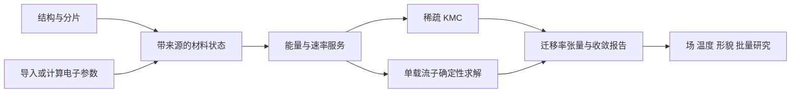

# cube 载流子输运软件设计与实施路线

日期：2026-11-05。状态：**完成调研后的建议设计；下列新模块/命令尚未实现**。用户已确定首批对象为有机分子晶体、非晶和聚合物。软件产品名为 **cube**；现有四语言通用 KMC 作为其基础组件保留。材料级目标是从可追溯结构/电子参数得到电子和空穴的迁移率张量、扩散、漂移、场温依赖及收敛证据。

依据：[软件调研](../research/software-survey.md)、[源码审读](../research/source-review.md)、[理论契约](../research/transport-theory.md)。这些文档描述当前已查阅的证据，不表示完整复刻任何上游程序。

## 1. 路线选择

| 路线 | 收益 | 主要成本 | 结论 |
|---|---|---|---|
| A：仅把通用 KMC 包装成材料程序 | 快速产生轨迹 | 缺结构映射、能量模型、迁移率协议、收敛与可追溯参数，难以成为可用材料软件 | 保留为组件，不作为完整产品终点 |
| B：材料级多尺度工作流＋两种输运求解器 | 利用已有真实数据；KMC 与确定性解可核对；同时覆盖晶体、非晶与聚合物跳跃域 | 需认真设计数据、物理假设、单位、片段和后处理 | **推荐，按下列里程碑实现** |
| C：立即同时实现全量子参数、BTE、非绝热动力学与 OLED/FET 器件 | 长期覆盖面广 | 各自是大型物理/数值项目，缺少共用小基准会使验证困难 | 保留扩展边界，分阶段立项 |

选择 B 的依据是现有代码和输入可以支持可验证的 hopping 材料工作流；不是认定所有有机材料都适用局域跳跃。对超出适用域的结果必须保留模型标签与限制。

## 2. 当前工程的准确状态

| 能力 | 当前证据 | 差距 |
|---|---|---|
| 通用 direct SSA | `src/universal_kmc/core.py`、C++/Rust/Fortran 对应内核和测试 | 全事件扫描；需材料出边专用路径与生产随机流 |
| 基础速率 | 四语言 Marcus/MA/Arrhenius，已有数值比对 | 缺统一位点自由能/场/环境参数服务；缺量子振动速率 |
| 单载流子周期图 | `Graph` + 显式边位移；KMC1/CSV | 缺正式晶胞、片段、能量和数据来源模型 |
| 真实体系分析 | `scripts/run_molecular_kmc.py`、100 位点/550 对、空穴/电子各 256 条 10 ns | 依赖特定目录/编号；只支持该脚本的正交盒/结构和零场无序假设 |
| 确定性 D | 脚本 `exact_benchmark`，封闭二聚体/周期游走测试 | 仅对称静态连通率、均匀 π；不是一般有场求解器 |
| 跨语言正确性 | 四语言真实图逐事件对照、原生/统计测试 | 256 条统计轨迹不是每种语言都运行过；材料功能需新的统一测试矩阵 |
| 性能证据 | `runs/performance_2026-11-02` | 当前扫描 1100 通道的计时不能当作优化后上限；先改事件数据结构再重新测量 |
| 外部参数 | 用户数据的哈希/1100 个耦合核对与周期镜像修正 | 未集成完整量化任务调度、通用参数导入和环境极化 |
| 软件名 | GitHub 仓库 cube | 分发名/import/CLI 仍为 universal-kmc/ukmc，需要兼容迁移 |

当前基线仓库提交为 `3ce0922053d8584efca6fefc3ff1daffe0d51ae2`，本次先交付设计文档及研究验证。没有把尚未实现的模块写成已可用功能。

## 3. 分层架构



建议模块与契约：

| 模块 | 责任与输出 | 明确边界 |
|---|---|---|
| `cube.structure` | 晶胞、PBC、原子/分子/片段映射、晶体对称性、聚合物链与连接 | 不从几何距离猜测未知电子耦合 |
| `cube.parameters` | 位点形成能、V、λ、振动参数、来源/方法/单位、缺失状态 | 不把 HOMO/LUMO 自动等同凝聚态自由能 |
| `cube.quantum` | 外部量化任务描述、生成/读取、缓存与失败恢复 | 首先对接而非重写 SCF/DFT；未安装的后端只支持已定义的导入模式 |
| `cube.rates` | 温度、场、静电、相互作用→定向 log-rate/rate；详细平衡诊断 | 不改变位点与镜像 ID；量子/经验模型必须显式选择 |
| `cube.transport` | `bulk_diffusion`、`bulk_drift`、`tof` 协议、初态和平衡 | 一种测量协议不能隐式替代另一种 |
| `cube.backends` | Python/C++/Rust/Fortran 的规范化数据接口、能力查询与执行 | 不静默退回别的后端或不支持的物理近似 |
| `cube.exact` | 生成元、稳态、corrector、漂移/扩散、后续 MFPT | 按闭合类报告有效性；检查残差而非只看求解器返回成功 |
| `cube.analysis` | 分段常数采样、协方差、拟合窗、轨迹/形貌误差、张量和图 | 将未收敛与零输运区分；不默认用总 MSD/6t 处理所有情形 |
| `cube.workflow` | prepare→parameterize→rates→run→analyze；温场扫描、检查点/恢复、批任务 | 每步可单独运行、输入输出可审计 |

通用 `universal_kmc` 可继续服务其他 KMC 问题；输运数据和电子结构依赖放在 cube 应用层。通用事件抽象无需承载所有材料字段。

## 4. 数据模型与可交换文件

先版本化 schema，后扩展前端。规范内存中长度统一 m、能量 eV、时间 s、温度 K、场 V/m、电势 V；导入层接受显式标记的 Å/nm/meV 等并转换。HDF5 各数据集也必须带单位，索引和晶格镜像为整数。

### 必需对象

- `Cell`：3×3 H、行矢量约定、三个 PBC 开关、实验轴到笛卡尔变换。
- `Site`：稳定 site_id、分子/链/片段 ID、中心及原子映射、电子/空穴 G^0 与方法标签、必要的类型/环境信息。
- `Edge`：edge_id、i/j、image[3]、位移或由晶胞可验证重建的位移、通道类型、V、成对 λ、可选速率覆盖值、参数状态及来源。
- `Parameters`：方法、量化程序/版本、基组、环境模型、内/外球约定；`missing`/`computed_zero`/`estimated`/`imported` 明确区分。
- `RunConfig`：载流子/协议、T/F、初态、平衡期、观测时刻、随机源/stream、后端、停止条件、精度目标。
- `Result`：物理观测、统计误差、算法/代码/编译版本、种子/流、输入哈希、残差、收敛与删失状态。

### 存储与来源

首发使用可审查的 TOML 配置＋显式 schema 的 JSON/CSV 中间数据；大数组/生产结果使用可选 HDF5。四语言交换层先用规范化文本/数组，不强迫每个后端重新实现量化软件的文件解析。保持 KMC1 作为低级回归输入；不让它承载全部物理元数据。

`cube-state` schema v1 必须保存格式版本、单位、镜像、参数来源和缺失掩码。原始文件保留只读哈希/相对来源路径；绝不把用户机器路径当作可移植输入契约。缓存 key 包含结构、方法、基组、载流子、边界/电荷、软件版本，不能仅用分子对编号。

从现有 `transfer_integrals.csv` 迁移时：VH/VL 的 meV→eV 转换须由适配器配置确认；从原始结果/GJF核对分子映射和实际镜像；原 `com` 不直接当真实位移。对无法重建的记录中止或输出明确的 incomplete 数据集。

## 5. 四语言职责和分发

延续用户已有的四语言要求。**四语言都保留可独立运行的输运求解核心**，输入同一规范化网络，采用同一物理/数值契约并分别测试。首发材料级核心（Marcus、场、周期位移、单载流子 bulk KMC）要求四后端覆盖；不把其中三个仅当成演示代码。

建议 Python＋uv 承担工作流、接口和分析，C++ 为首个生产集成后端；选择基于其现有实现及稀疏代数/绑定生态，不能从一次测速认定 C++ 永远最快。Rust/Fortran 通过版本化文件/CLI 协议先接入；四语言回归内核保持独立。之后按需求加入窄 C ABI 或 Python 绑定，避免让 Python 包强制依赖所有编译器。

仅将参数化/分析前端做一份，避免四份量化解析器漂移。后端能力矩阵必须记录 sparse/exact/time-dependent/many-carrier 等支持情况。后续特性可以分期实现，但发布对应版本时需显式说明哪些后端支持，不削减四语言核心的交付要求。

产品名和用户命令为 cube。Python 分发名要在发布前核查重名，再决定 `cube-transport` 等候选；不在本阶段抢注或发布。兼容期保留现有 `ukmc` 和 `universal_kmc` 导入。新 `cube` 命令只有对应子命令实现后才写入可执行文档。

## 6. 阶段与验收门槛

阶段按依赖排序，不给尚未评估人力的交付日期。每一阶段需要小模型解析基准和真实数据闭环，不能以“能跑出一个数”结项。

### M0：固化基线与正式 schema

工作：保留已有回归，建立 cube 产品入口与兼容迁移方案；抽取特定体系脚本里的通用数据/分析职责，定义 Cell/Site/Edge/Parameter/Result schema、错误状态和 provenance。

验收：旧命令/旧样例仍通过；文本数据 round-trip 不改变镜像、单位、缺失状态与哈希；无软件后端的导入流程不触发假计算；读错单位/编号立即报错。

### M1：首个材料级 bulk 版本（四语言）

工作：通用显式电子参数导入；正交/三斜晶胞与镜像边；Marcus、电子/空穴、场、site-energy；出边 CSR；bulk_diffusion/bulk_drift；固定时间观测、完整张量；将 `e_006` 作为公开派生数据回归案例。

验收：四后端相同规范网络/便携随机流在保守编译设置下逐事件核对；1D/3D 均匀随机游走、双速率晶格、详细平衡、场反转/电荷反转、封闭二聚体和自镜像通道解析验证；材料导入保留完整 audit；同一负载重新测速度。预计算总率/累计率只访问当前出边，事件数固定时不因加入不可达远端边出现 O(全图边数) 的主导开销。

### M2：一般单载流子确定性解与收敛体系

工作：非对称稀疏 Q、稳态 π、corrector v/D、闭合类；后处理拟合窗、相关误差、分层形貌采样；小正负场线性响应与 Einstein 对照。

验收：矩阵和规范相对残差目标 ≤10⁻¹⁰（病态问题必须报告失败或更高精度需求）；π 归一性/非负性与 D 半正定；解析解与独立实现比较；KMC 均值与确定性解在预定统计误差内相容。多个闭合类不能返回无条件单一 μ。零场对称 `e_006` 张量应重现现有基准；有场/有位点能无序案例另验，不外推现有对称测试结论。

统计验收先登记精度和最大成本，使用固定样本/适当顺序置信规则。显著性检验不要求每一次随机运行落在 95% 区间；CI 覆盖率通过多个预设随机样本验证。接近零的输运分量用绝对误差目标。

### M3：晶体、非晶、聚合物参数工作流

工作：CIF/GRO/XYZ＋显式映射导入；晶体复制、聚合物连接/片段方案；多份形貌与距离截断收敛；外部量化任务规划/缓存/失败恢复；四点重组能、IP/EA/环境位点能；选定一套可重复的耦合方法。

实施顺序：先支持已算参数和现有 Gaussian/MOMAP 派生数据的显式解析；再选择一个可自动测试的量化后端（建议 PySCF，另给 Gaussian/ORCA 适配接口）。不能宣称 Gaussian/ORCA 的所有版本已支持；每种解析器绑定实际测试版本与样例。高通量可先生成任务并导入结果，授权软件不作为核心依赖。

验收：小分子四点能量逐项可追溯；同构二聚体/异构分子对/共价链段使用适用耦合方法；聚合物分片与链内/链间统计；晶体方向旋转与超胞复制不改变张量物理量；独立形貌样本误差独立于轨迹误差报告。至少一个晶体、一个非晶、一个聚合物完整材料工作流，各有来源明确的输入与参考结果。

### M4：改进速率与动态无序

工作：MLJ 和可收敛的量子振动参数输入；后续多模关联函数模块。将快照平均与真正时间依赖率分开；必要时实现积分 hazard/thinning，连接 MD 时间序列。

验收：MLJ 模数截断/极限检查、详细平衡适用条件和高温经典极限；有解析积分 hazard 的时变例子；切换时间边界与更新时钟的测试。缺振动参数禁止“全量子”计算；只有完成相同模型/约定的外部比较后才谈与 MOMAP 定量对照。

### M5：有限浓度、多载流子与 ToF

工作：先占据排斥，再库仑/长程边界；更新依赖图与事件树；吸收/注入区、ToF 生存统计/电流瞬态；生产 RNG 独立流、检查点与恢复。

验收：小格点多粒子生成元穷举；排斥/相互作用平衡与守恒；全量速率重算对照优化更新；单粒子 MFPT 与 ToF KMC；未到达轨迹、重启同流、检查点一致性；核对有限浓度迁移率/电导定义。

### M6：独立扩展项目

OLED/OFET 的接触/Poisson、复合与激子；强离域/非绝热/瞬态局域化；能带 BTE/AMSET/EPW/Perturbo 接口。每个项目先确定需要的物理输入与验证数据，再扩展规范，不能将未提供的效应暗中吸收到一个经验速率参数。

## 7. 首个交付用户流程（拟议，尚未实现）

```text
uv run cube prepare    case.toml       -> state + input audit
uv run cube parameters case.toml       -> imported/calculated electronic parameters
uv run cube rates      case.toml       -> directed rates + balance diagnostics
uv run cube run        case.toml       -> raw observables + checkpoints
uv run cube analyze    run_directory   -> tensor + uncertainty + convergence report
uv run cube validate   run_directory   -> physical/numerical verification report
```

输入 case.toml 要由 schema 和可运行样例定义，不能在设计阶段让用户以为这些命令已可执行。报告至少显示材料/载流子、理论、参数来源、T/F、边界、初态、平衡、误差、停止原因和可复现命令。

## 8. 性能与数值可靠性

1. 首先消除每事件对全图边扫描；静态单粒子缓存当前位点总率和累计率，选择可用线性/二分/alias，比较成本后决定默认路径。
2. 增加流式统计/可配置观测频率，不默认逐事件写 CSV。内核、格式化、磁盘 I/O、量化前处理分别报告速度。
3. 并行优先独立轨迹、温场点和形貌，不先并行一个事件序列。每个任务独立 stream，任务调度顺序不能改变随机流分配。
4. 多载流子事件树仅在正确失效/更新机制已核对后引入。长程相互作用使“局部更新”可能不局部。
5. 性能测试继续同时保存正确性 signature、原始重复计时、CPU/编译参数、源码版本。不预承诺固定加速倍数。
6. 协议允许 log-rate、尺度化稀疏求解、动态范围诊断；总率溢出/时间不推进不能掩盖成零迁移率。

## 9. 开发依赖、许可证与发布

以 MIT 的独立 cube 实现为目标。文档/公式和接口思想可以研究，直接引入任何上游源码之前单独核对实际文件许可证与依赖；本次没有把所克隆源码放入发行物。GPL 项目不直接复制进 MIT 内核；需要其功能可采用独立实现或明确授权且隔离的可选工具链。AMSET 的完整 LICENSE 含额外贡献文字，不能只凭“BSD”二字作兼容结论。

uv 管理 Python 环境/锁文件；核心仅依赖数值/数据所需最小集合，量化/MD/绘图/HDF5/原生绑定按 optional extras 安装。阶段引入新依赖时提交锁文件并验证 wheel/sdist。四种编译器是开发/原生构建要求，不自动变成每个 Python 用户的安装前置条件。

正式发布前新增：最小可运行 case、schema 文档、参数计算说明、可复现验证、引用文件、变更记录、后端能力表、CI 编译/数值回归。现有 CMake 可选路径尚未实测，要在将其设为发布构建入口前验证。

## 10. 风险与下一步的具体顺序

| 风险 | 优先动作/判据 |
|---|---|
| 聚合物片段过小导致错误局域假设 | 链内耦合与分片敏感性；强耦合案例不输出无条件 hopping 预测 |
| 位点能/耦合/重组能约定不一致 | 单位与方法元数据，正反边详细平衡，对原始量化结果逐项追溯 |
| 参数已算但分子编号或镜像不匹配 | 结构映射、hash、显式 image；错误时停止，不补猜测 |
| 陷阱与形貌尺寸导致假收敛 | 物理时间、拟合窗、温场/尺寸/截断和独立形貌收敛 |
| 仅对称解被误当通用解 | 非对称/位点能/场测试作为 M2 硬门槛 |
| 后端实现漂移 | 版本化规范数据、能力矩阵、四语言核心交叉验证 |
| 同时扩展过多物理模型 | 按 M0→M1→M2，之后 M3/M4/M5 分可验证增量推进 |

下一次实现应从 M0 的 schema、配置和可追溯导入开始，随后完成 M1 的通用材料级四语言 bulk 路径。`e_006` 是首个回归案例；它不能替代对有位点能无序、三斜晶胞、聚合物分片和有场输运的独立验收。
