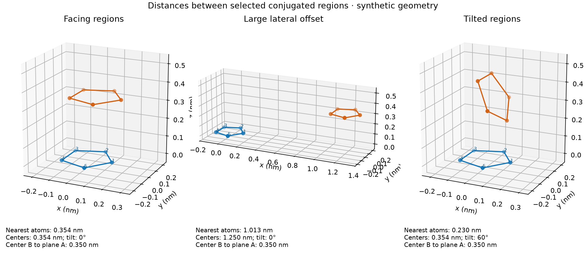

# 共轭区域距离定义的数值例子

这是五个共面点组成的示意区域，不是真实分子，不是实际材料计算或已采用的筛选默认值。长度单位 nm。每个构型都有独立编号 1–5 的两组点。

| 构型 | 最短所选原子距离 | 几何中心距离 | B 中心到 A 平面的距离 | 横向错位（相对 A） | 倾角 |
|---|---:|---:|---:|---:|---:|
| 近距离正对 | 0.354 | 0.354 | 0.350 | 0.050 | 0.0° |
| 横向明显错位 | 1.013 | 1.250 | 0.350 | 1.200 | 0.0° |
| 倾斜 60° 接触 | 0.230 | 0.354 | 0.350 | 0.050 | 60.0° |

观察：

- 前两种情形的垂直距离均为 0.350 nm，但第二种的有限区域已经相距较远。只用平面垂直距离会把这种侧向远距离构型选入。
- 第三种的无限平面会相交，其数学最小距离为 0；但两组所选原子的最近距离是约 0.230 nm。非平行面不存在与平行面相同含义的单一层间距。
- 以 0.600 nm 为**示意阈值**，最短原子距离和几何中心距离均选择第一/第三种，排除第二种；只用 B 中心到 A 平面的距离则选择全部三种。这个例子不证明上述两个有限区域指标总是作出相同选择。
- 几何筛选只是生成量化候选对，不根据某个几何阈值直接断言转移积分大小。

建议软件同时计算可解释的多个指标，运行配置显式指定主筛选规则与阈值，而不是将“平面距离”写死成一种未说明的量。用户尚未选定默认规则；这些例子不替代用户答复。



[精确坐标和测量值](measurements.json)。复现：

```bash
python3 scripts/illustrate_dimer_distances.py
```

该脚本需要 NumPy 和 Matplotlib，运行时包含公共刚体变换的不变性和简单解析值检查。图中每个子图按不同空间范围绘制，坐标轴标明实际单位。
