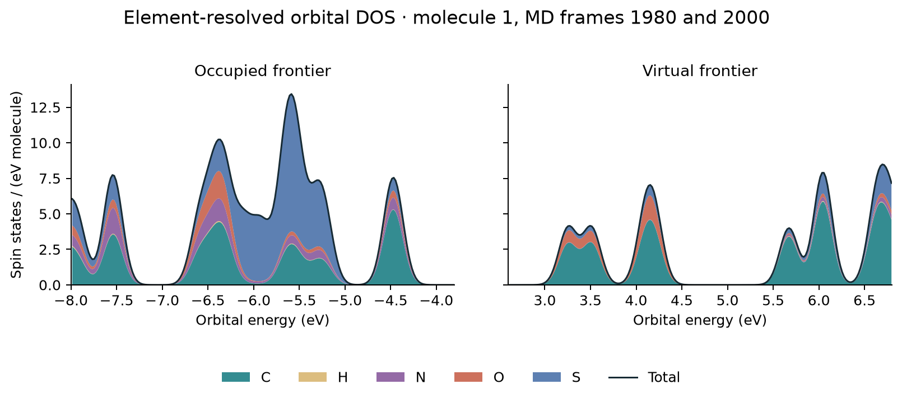
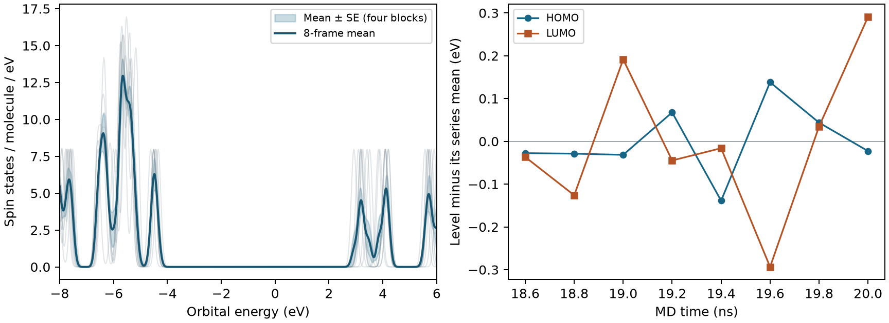
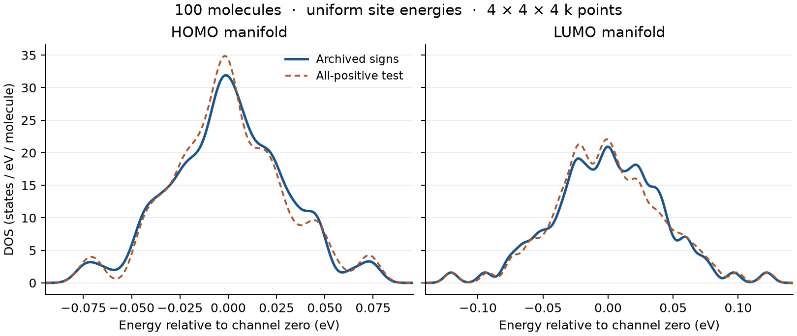
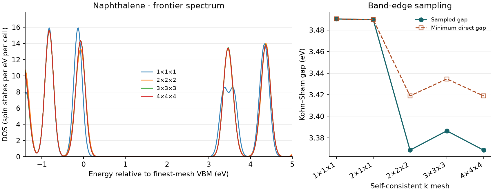
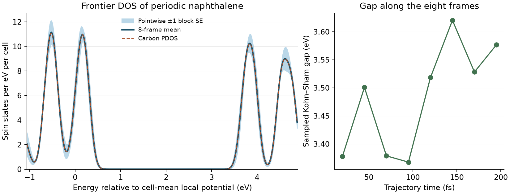
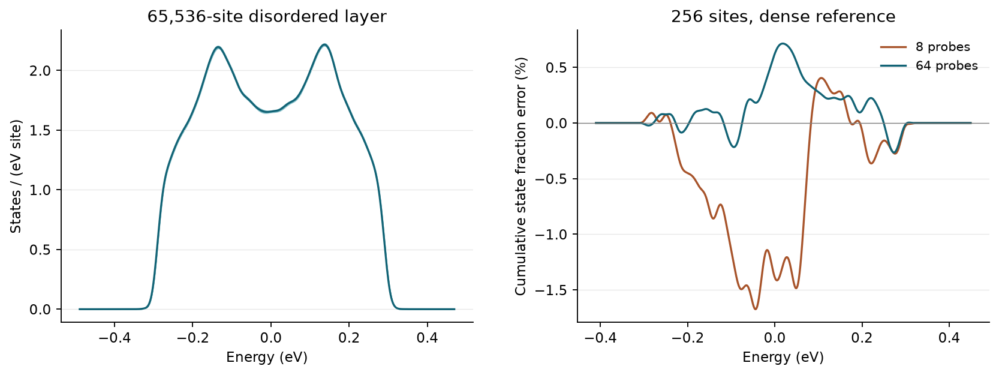

# 验证范围与待完成项

## CMake 构建验收

Linux Release 构建通过全部 9 组 CTest，四语言测试逐事件核对同一随机种子的模型轨迹。从 uv 生成的源码包解压到新目录后，重新配置、编译并通过相同 9 组检查。Python-only 配置通过 wheel 测试与安装前缀重定位；原生 Debug 构建通过 Ninja 与 Ninja Multi-Config 验证。独立的 C++ 和 Fortran 应用都能用 `find_package(Wren 0.2 CONFIG REQUIRED)` 链接安装库。

仅启用 Python 时，CTest 也运行 Python 科学模块回归。仅启用 `WREN_BUILD_DOCS` 时，
可独立构建 HTML 并安装 `Documentation` 组件。已用从完整 CMake 前缀安装的
`wren-dos` 在仓库外运行非正交示例，得到每晶胞 4 个自旋态。

## 已有依据

- 载流子与模型 FSSH 分支已在 Wren 工作区合并，更名后的回归包含四语言 KMC 一致性测试。
- DOS 数学测试覆盖 Gaussian 积分/矩、自旋/分数权重、周期单链解析色散、耦合符号干涉、
  反向通道重复拒绝及静态/动态总体方差恒等式。
- H2 的主 `$dos` 入口及独立 TOML 命令已实际执行，输出 PySCF 轨道、DOS 和积分核验。
- 一个完整 H2 周期晶胞以 PySCF、两个 k 点实际完成，作为 PBC 功能验收，不代表真实有机
  晶体的基组/k 点收敛结果。

实际 MD 的 frame1980/frame2000、分子 1（86 原子）已完成 CPU HF/STO-3G 真空轨道谱功能验证，
使用 Weigend 辅助基，用时约 452 s；DOS 积分与 604 个自旋态相符。这不是基组/辅助基收敛的
材料 DOS，两帧也不足以估计时间采样不确定性。结果保留在仓库 runs/wren_2026-11-23/validation.json。
只有终态和科学输出核对完成才计入验证，运行中任务不算完成。

## 非正交片段与 PySCF 元素投影

非正交单链用解析色散 $E(k)=(\epsilon+2t\cos k)/(1+2s\cos k)$ 核对。双位点模型在
复数 Bloch 相位下，用 SciPy 的广义 Hermitian 求解器独立核对能级、Löwdin 位点权重和
$H\mapsto H+aS$ 的能量平移。周期 PySCF 测试使用 LiH 晶胞的三个 k 点。

重新计算 `anneal_a` 的第 1980、2000 帧，每帧选同一个 86 原子单体（编号 1）。
CPU 四线程、密度拟合 HF/STO-3G、Weigend 辅助基、Gaussian 标准差 0.1 eV，
两帧运行共 536.9 秒。每分子有 302 个空间轨道，计入自旋后积分为 604。
元素积分为 C 340、H 72、N 40、O 80、S 72。各能量点的元素和相对总 DOS 最大绝对
偏差为 $6.54\times10^{-13}$ 态/(eV·分子)。另从两份检查点读取波函数，以 SciPy
矩阵平方根和 AO 标签独立重建 250 个网格点，每个元素曲线的最大绝对偏差为
$9.42\times10^{-14}$ 态/(eV·分子)。[数值记录](https://github.com/Tiny-Cube/cube/blob/feat/wren/runs/wren_dos_projections_2026-11-23/md-element-pdos.json)

图中能量以单体 HF 轨道能为参考，两幅图分别放大占据和虚轨道的前线能区。
这是两帧真空单体的数值验收，体相能谱还需要分子间耦合、环境模型和采样收敛验证。

### 同一分子在 1.4 ns 内的构象取样

从你的 GROMACS 轨迹 `anneal_a.xtc` 选择第 1860 至 2000 帧，每隔 20 帧取一次，对应 18.6–20.0 ns，间隔 200 ps。每个构型按 TPR 键连接重构 1 号完整分子（C₃₄H₃₆N₄O₈S₄），然后用真空 RHF/STO-3G 和 Weigend 密度拟合计算。6 帧为新增单点，另 2 帧的同方法检查点与独立计算核对过。8 帧的总 DOS 分别积分为每分子 604 个自旋态。[原始轨道能与复算脚本](https://github.com/Tiny-Cube/cube/tree/feat/wren/runs/wren_md_ensemble_2026-11-23)

| 轨道量 | 八帧均值 (eV) | 八帧总体标准差 (eV) | 取两帧为一块的均值标准误 (eV) |
|---|---:|---:|---:|
| HOMO | −4.4808 | 0.0774 | 0.0101 |
| LUMO | 3.2200 | 0.1688 | 0.0721 |
| 轨道间隙 | 7.7008 | 0.2155 | 0.0664 |

这些数值描述一个分子的构象波动。四个两帧块给出的误差随块长变化；空间无序、环境极化和分子间杂化还需要额外的分子及相互作用信息。正的 HF 虚轨道能不能直接解释为电子亲和势。[无定形有机材料中的静态与动态能量无序](https://doi.org/10.1021/acs.jpcc.0c11219)

### 100 分子整盒的 HOMO 与 LUMO 有效谱

对于同一体系第 2000 帧，分别把 100 个 HOMO 或 100 个 LUMO 作为正交局域轨道，加入已有的 550 对带符号分子间耦合及其晶格镜像。在这次对照中，各通道独立设均匀零位点能，以量出单由耦合引起的谱展宽。用 4×4×4 k 网格得到 HOMO、LUMO 带宽 **150.684、242.533 meV**。每条谱对能量积分为每分子 2 个自旋态。三组 k 网格、轨道相位变换核验和可选的逐分子 SCF 位点能输入均可复算。[有效谱、输入表及复算命令](https://github.com/Tiny-Cube/cube/tree/feat/wren/runs/wren_effective_dos_2026-11-23)

对任一分子轨道翻相，同时改变所有相连矩阵元的相位，计算的全部能级在舍入误差内保持一致。将每条边分别取绝对值会改变闭合回路上的干涉，两个通道中采样能级的最大变化分别为 7.94 和 7.33 meV。历史 dimer 的单体检查点未完整归档，无法独立证明全部耦合处于同一轨道相位约定。定量材料谱还需要核实这一约定，并提供同一帧 100 个位点在共同参考下的能量。两套零位点谱之间的间距没有物理意义。

### 从单体 XYZ 开始的 CPU/GPU 对照

在同一台 RTX 5090 主机上，从相同的 86 原子 XYZ 分别启动四线程 CPU PySCF 和 GPU4PySCF，
计算密度拟合 HF/STO-3G，使用 Weigend 辅助基。两端各自求解自洽场，再投影到五种元素，
在同一 0.02 eV 网格上用 0.1 eV 的 Gaussian 展宽。表中时间包含 SCF、检查点、投影和输出，
每个设置各运行一次。[逐项精度与计时记录](https://github.com/Tiny-Cube/cube/blob/feat/wren/runs/wren_kpm_2026-11-23/rtx5090-projections.json)

| SCF 阈值 (Hartree) | CPU | GPU | 加速比 | 302 个轨道中最大能量差 |
|---|---:|---:|---:|---:|
| $10^{-7}$ | 78.17 s | 5.47 s | 14.30× | 0.835 meV |
| $10^{-10}$ | 101.17 s | 6.25 s | 16.18× | 0.0259 meV |

两种阈值下 CPU 和 GPU 的总 DOS 均积分为 604。收紧阈值后，HOMO 与 LUMO 的两端差分别为
$6.68\times10^{-7}$ 和 $1.47\times10^{-6}$ eV。固定同一检查点，再单独比较两个后端的
Löwdin 投影，逐轨道元素权重最大差为 $6.89\times10^{-15}$，在 −8 至 7 eV 窗内的元素
PDOS 最大差为 $2.14\times10^{-14}$ 态/(eV·分子)。非正交双位点链另以 32 个 k 点验证，
两端广义本征值最大差为 $5.56\times10^{-16}$ eV。

## 实验萘晶胞的周期 DOS 与 GPU 验证

取 Fabbiani 等在 298 K、0.4 GPa 测得的萘晶胞，由论文列出的分数坐标和空间群重建两个完整 C₁₀H₈ 分子。两个设备均采用 PBE、GTH-PBE 赝势、GTH-SZV 基组、自动辅助基、2 级 Becke 网格和 0.10 eV Gaussian 宽度。SCF 能量阈值为 $10^{-8}$ Hartree。该算例给出一个实验晶体构型的 Kohn–Sham 谱。对于自己的 MD 帧，可以在相同控制文件中换入含晶格和分子原位置的提取清单。[实验结构](https://doi.org/10.1107/S0108768106026814)、[控制文件与输入方法](dos-guide.md)

在同一台 Xeon Platinum 8380 工作站上，四线程 CPU 和单张 RTX 5090 顺序完成相同的 $2\times1\times1$ 计算。两者端到端单次用时分别为 **167.36 s 和 11.85 s**，比值为 **14.1**。总能差为 $3.13\times10^{-7}$ Hartree，逐 k 点全部轨道的最大绝对能量差为 **0.0423 meV**。在公共能量点线性插值后，C、H 投影曲线的最大绝对差分别为 0.00187、0.00102 态/(eV·晶胞)。硬件、PySCF 2.15.0、GPU4PySCF 1.9.1 和 CuPy 13.6.0 都与该计时相关。[两端数值记录](https://github.com/Tiny-Cube/cube/blob/feat/wren/runs/wren_periodic_2026-11-23/naphthalene-cpu-gpu.json)

| RTX 5090 的 k 网格 | 采样带隙 (eV) | 最小直接间隙 (eV) | 相对上一网格的 DOS 总变差 | 用时 (s) |
|---|---:|---:|---:|---:|
| 1×1×1 | 3.49026 | 3.49026 | — | 13.86 |
| 2×1×1 | 3.48968 | 3.48968 | 0.10244 | 11.85 |
| 2×2×2 | 3.36857 | 3.41887 | 0.14106 | 21.55 |
| 3×3×3 | 3.38649 | 3.43462 | 0.03993 | 71.43 |
| 4×4×4 | 3.36857 | 3.41889 | 0.01453 | 165.36 |

五种网格的占据数均为每晶胞 96 个电子，DOS 积分均为 192 个自旋态。最后两次的总能变化只有 $1.77\times10^{-5}$ eV/晶胞，采样带隙仍变化 **17.9 meV**。在 4×4×4 网格上，价带顶出现在倒格分数坐标 (½,½,0)，导带底出现在 Γ。3×3×3 网格未包含前一个点。计算所需的 k 网格密度取决于关心的能量尺度，得到准粒子或光学间隙还需要对应的电子激发模型。[完整网格报告](https://github.com/Tiny-Cube/cube/blob/feat/wren/runs/wren_periodic_2026-11-23/naphthalene-mesh-study.json)、[64 点的总 DOS 与元素 PDOS](https://github.com/Tiny-Cube/cube/blob/feat/wren/runs/wren_periodic_2026-11-23/naphthalene-finest-dos.csv)

另用 H₂ 周期晶胞的三个 k 点验证 KRHF，包括分数波矢 (⅓,0,0)。CPU 与 GPU 的最大能级差为 0.0211 meV。固定在 GPU 上做 SCF 后，将 Löwdin 投影和展宽切换至 CPU，能级逐项相同，元素 PDOS 最大差为 $6.22\times10^{-15}$ 态/(eV·晶胞)。[HF 对照](https://github.com/Tiny-Cube/cube/blob/feat/wren/runs/wren_periodic_2026-11-23/h2-hf-cpu-gpu.json)、[混合设备对照](https://github.com/Tiny-Cube/cube/blob/feat/wren/runs/wren_periodic_2026-11-23/h2-hf-gpu-mixed.json)

## 周期 MD 八帧的共同能量参考与统计

从上述萘晶胞出发，先用 GFN-FF 优化原子和晶格，体积从 337.65 变为 301.99 ų，再在固定晶格上传播 0.20 ps。Berendsen 热浴目标为 298 K，此段动力学的平均动温为 327 K。选择 0.020–0.195 ps 之间的 8 个等间隔快照，每帧保留 36 个原子。归档提供实际计算所用的坐标和哈希。[可用的帧与控制文件](https://github.com/Tiny-Cube/cube/tree/feat/wren/examples/dos/naphthalene-md)、[GFN-FF](https://doi.org/10.1002/anie.202004239)、[Berendsen 热浴](https://doi.org/10.1063/1.448118)

RTX 5090 用 **86.51 秒** 完成八帧的周期 PBE/GTH-SZV、2×1×1 k 网格、元素投影和 Gaussian 展宽。固定胞中自动计算的局域平均势为 −0.0119360 eV。每帧占据 96 个电子，平均 DOS 的积分为每晶胞 192 个自旋态。逐帧采样带隙从 3.368 到 3.620 eV。独立程序直接读原始能带，减去记录的势并求和重建平均 DOS，得到的最大逐点差为 $3.6\times10^{-15}$ 态/(eV·晶胞)。[独立复算脚本与结果](https://github.com/Tiny-Cube/cube/tree/feat/wren/runs/wren_periodic_md_2026-11-23)

图中阴影为 4 个两帧块给出的一个逐点标准误。重用同一批原始谱，将块长由 1 增至 2、4 帧时，全能量范围内的最大逐点标准误分别为 2.58、3.03、4.62 态/(eV·晶胞)。最大块长只留下两个块。这段轨迹验证对齐、轨道权重与误差计算，平衡材料谱需要更长的独立采样、更大的晶胞和 k 网格收敛。[手册中的分块操作](dos-guide.md)

## 稀疏 DOS 的精度与规模

256 位点的无序周期层用稠密对角化求出全部能级。下表比较归一化累计态数，分别给出随机迹
相对相同 Jackson 核精确谱的最大差，以及 Jackson 核精确谱相对离散谱的最大差。
第二项只依赖矩数和缩放，适合区分采样波动与有限谱分辨率。[控制参数与完整结果](https://github.com/Tiny-Cube/cube/blob/feat/wren/runs/wren_kpm_2026-11-23/local-cpu.json)

| 矩数 | 随机向量数 | 随机迹差 | 有限核宽差 |
|---:|---:|---:|---:|
| 64 | 8 | 1.51% | 0.84% |
| 64 | 64 | 0.66% | 0.84% |
| 128 | 8 | 1.67% | 0.63% |
| 128 | 64 | 0.71% | 0.63% |

左图为 128 个矩、16 个随机向量的每位点 DOS，阴影为一个随机迹标准误。
右图固定 128 个矩，在同一能量格点比较随机迹与稠密参考的累计态数。

在同一台 RTX 5090 主机顺序运行三次 CPU 单线程与三次 GPU，使用相同输入、种子及
512 个能量箱。下表为 Wren KPM 任务墙钟时间的中位数，包含读入、矩阵组装、递推和写出，
计时起点为读取既有 Hamiltonian。[同机逐次计时与精度](https://github.com/Tiny-Cube/cube/blob/feat/wren/runs/wren_kpm_2026-11-23/rtx5090.json)

| 模型与求迹方式 | CPU | GPU | CPU/GPU | 两端积分 |
|---|---:|---:|---:|---:|
| 65,536 位点合成无序层，16 个随机向量 | 1.682 s | 0.767 s | 2.19× | 65,536 |
| 86 原子 MD 单体的 302 维 Fock 矩阵，精确迹 | 1.759 s | 1.277 s | 1.38× | 604 |

无序层含 131,072 条键。逐箱 DOS 的最大 CPU/GPU 差分别为 $6.66\times10^{-10}$ 和
$2.93\times10^{-14}$ 态/eV。第二项用同一中性检查点构建 Löwdin AO 哈密顿量，GPU 的
128 个矩相对原轨道能量的最大绝对差为 $9.33\times10^{-12}$。此例的谱宽包含深芯轨道，
128 个矩适合检验算子和态数；前线能级的分辨率需单独收敛。另一个 32 k 点复数 Bloch
算例的 CPU/GPU 最大谱矩差为 $2.23\times10^{-15}$。复现命令为
`python scripts/validate_kpm.py --output <新目录> --backend cpu --checkpoint <单体.chk>`，
将后端改为 `gpu` 可作同机对照。

## 单载流子与量化驱动的表面跳跃

在 `e_006_ether_12-17_0` 的单帧静态周期网络上，Python CPU 与 RTX 5090 用同一组种子完成 30,479,173 次载流子跳跃，2,048 条空穴和 2,048 条电子轨迹的事件数和每个采样时刻位移逐项相同。两端各运行一次，分别用时 160.63 和 1.42 秒，空穴和电子张量的相对 95% 区间范数分别为 0.159 和 0.160。[统计判据与复算方法](gpu-kmc.md)

在孤立的面对面乙烯二聚体阳离子上，用两个双重态的 CPU SA-CASSCF(3,2)/STO-3G 能量、解析梯度和态间耦合推进 FSSH。在 A 上制备局域空穴，其初始净电荷为 +0.999908 e。经过 0.2903 fs，A 与 B 分别带 +0.986649 e 与 +0.013351 e。步长减半后，末态片段电荷差为 1.45×10⁻⁸ e，总能量最大漂移由 7.05×10⁻⁹ 降为 1.70×10⁻⁹ Hartree。两次均未抽中离散跃迁，电荷变化来自所跟踪波函数的相干演化。这组短轨迹验证有限分子的态间耦合与电荷观测量。[运行方法和量化依据](fragment-hopping.md)、[逐步对照](https://github.com/Tiny-Cube/cube/tree/feat/wren/runs/wren_doublet_fssh_2026-11-23)

## 材料预测的适用范围

| 研究问题 | 还需处理的物理或数值因素 |
|---|---|
| 无序体相 DOS 和带尾 | 多分子和独立轨迹采样、环境响应、超胞大小、基组/泛函与共同能量参考 |
| 稀疏非正交求谱 | 当前 KPM 处理正交大模型，显式重叠使用稠密广义对角化 |
| 环境中的非绝热输运 | 实际材料活性空间、环境、热初态系综、长时间输运和尺度收敛 |
| 激发态 QM/MM 或高阶多极 | 自动激发态适配器的能量及梯度校验、环境极化模型 |

## RTX 5090 实机验证

PySCF 2.15.0、GPU4PySCF 1.9.1、CuPy 13.6.0，设备 RTX 5090。
小分子 CPU/GPU 轨道最大差为 7.14e-13 eV；1000 能级、4001 网格点的 Gaussian 展宽
最大差约 1.36e-12，16 位点/8 k 点 Bloch 谱最大差约 7.77e-16 eV。

实际 86 原子单体在同一服务器、8 CPU 线程、HF/STO-3G、Weigend 辅助基、SCF 阈值 1e-7 下，
CPU 48.62 s、GPU 3.92 s；单次观测约 12.4 倍。GPU 已由小分子测试预热，包含数据转换/输出开销，
不是重复采样的统计性能结论。两端总能差约 2.83e-8 Hartree，最大轨道差约 0.835 meV。
这些是实现级数值/性能验证，不说明这套小基组/辅助基对该材料已收敛。

## 两态、振动模与冻结簇

- H₂ 的真空 RHF/singlet-TDA、6-31G 四点优化得到 S₁ 面上的形变能 2.590214 eV。在同一 S₀ 结构上使用 RHF Hessian 和 TDA 垂直梯度时，单模 VG 估计为 1.428673 eV。VG 结果也与直接用伸缩模曲率求逆得到的数值一致。这两个数值展示了同一分子的两种物理近似。
- CPU B3LYP/6-31G 的 H₂ 示例经 `wren` 入口给出 S₀ 和 S₁ 两项分别约 2.681 和 1.807 eV。该数值用于软件验证。
- 苯的 12 原子真空例子从平面构型出发，B3LYP/6-31G 的 SCF/TDA 四点计算得到 S₀ 形变能 0.140952 eV、S₁ 形变能 0.141546 eV，两项和 0.282497 eV。两次优化分别用了 4、6 次梯度评估。最小筛查能隙为 1.108 eV，相邻评估的 S₁ 振幅重叠最低为 0.9982。此例未做频率验证。
- 真实 frame 2000 的分子 1 以 6 Å 截取 86 个 QM 原子、1,892 个 MM 原子（22 个完整邻居镜像）。经三个文件导出、再读入后，原子顺序、坐标和点电荷逐项一致。两边的 QM–MM LJ 能均为 −0.1694510086 Hartree，非零 LJ 梯度逐项一致。
- 三片段表面跳跃例子用 16 条轨迹、每条 200 步，出现 3 次接受跳跃。最大总能漂移约 $1.98\times10^{-10}$ Hartree。参数属于示例模型。

复现实例与核验数据见[本轮验证记录](https://github.com/Tiny-Cube/cube/tree/feat/wren/runs/wren_state_pairs_2026-11-23)。

## 同一 MD 几何的垂直电离能与电子亲和能

对 frame 2000 的 86 原子单体，在相同几何上用 B3LYP/STO-3G、Weigend 密度拟合、1 级积分网格计算三个电荷态。CPU 和 RTX 5090 都达到 SCF 阈值 1e-7 Hartree。CPU 的垂直 IP 为 3.948143 eV，EA 为 −0.974198 eV，两端差分别为 5.84e-6 eV 和 2.18e-6 eV。每个加/减电子通道积分为 1。首次尝试的 HF 阴离子在 100 步内未收敛，未纳入此对照。B3LYP 的单次墙钟时间分别为 546.50 s 和 43.60 s，两次任务在同一主机上有重叠。这个有限基组的单个真空快照用于设备一致性核验，材料能级还需环境、扩散基函数与采样收敛检查。[原始验证数据](https://github.com/Tiny-Cube/cube/blob/feat/wren/runs/wren_state_pairs_2026-11-23/gpu-dos.json)
