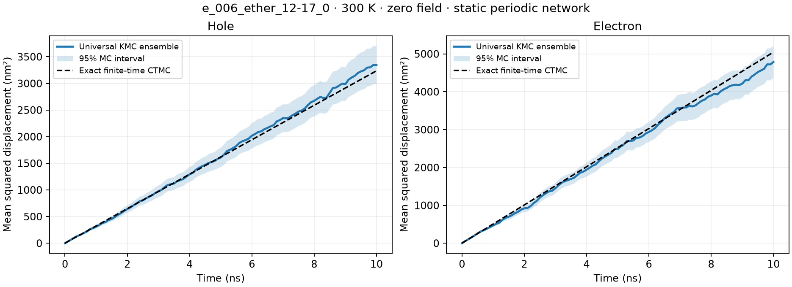

# e_006_ether_12-17_0 真实体系验证

2026-11-02 完成。100 个分子、8600 个原子、550 个分子对；周期盒长为 4.57679 nm。空穴与电子的正速率网络均连接全部 100 个分子。四种语言在相同种子下逐事件、逐状态一致，本次输出的时间差为 0。

## 数据与速率

输入为用户提供的 `transfer_integrals.csv`。全部 1100 个 VH/VL 值与原始 MOMAP `.inf` 文件逐项核对，单位确认为 meV。重组能来自 `e_006.csv` 的对应分子行。采用经典非绝热 Marcus 公式：

```text
k = (2π/ℏ) |V|² / sqrt(4π λ kB T) × exp[-(ΔG + λ)² / (4 λ kB T)]
```

这里 V、λ、ΔG 用 eV，ℏ 用 eV·s，输出速率为 s⁻¹。假设 T = 300 K、零电场、相同位点能（ΔG = 0）、静态周期结构、单载流子；仅使用已有的 550 对耦合。没有把未知位点能或缺失耦合当作已计算数据。

| 项目 | 空穴 | 电子 |
|---|---:|---:|
| 重组能 / eV | 0.310715784506 | 0.348854567167 |
| 有向通道数 | 1100 | 1100 |
| 正速率通道数 | 1098 | 1100 |
| 最小速率 / s⁻¹ | 0 | 971.661942 |
| 最大速率 / s⁻¹ | 7.74252817 × 10¹² | 1.24519893 × 10¹³ |

根目录 CSV 的 `2mol` 列均为同一个标签，因此采用 `mol_i`/`mol_j` 识别分子。其 `com` 距离也不能直接用于位移：与本次重新计算的核质心距离相比，513/550 对差异超过 0.002 nm，最大差异 0.06253135 nm。保留原始耦合，根据 `anneal_a_fix.gro`、1-based `core.txt` 和 550 个实际二聚体 GJF 重新确定周期镜像及位移。逐原子几何检查的最大差异为 0.00112305 nm，二聚体核质心位移最大差异为 0.000600281 nm。原始输入未改动。

全部源文件的 SHA-256 与假设记录在 [input_audit.json](input_audit.json)，路径相对于输入目录。计算后的耦合、几何、周期镜像及速率见 [rates_and_geometry.csv](rates_and_geometry.csv)。

## 验证结果

Python、C++、Rust、Fortran 分别运行每种载流子的 10000 事件轨迹（seed=42）和 1 ns 截止轨迹（seed=20261102），逐行对照事件、状态、位置和时间。10000 事件轨迹均访问全部 100 个位点；1 ns 轨迹分别发生 1024 和 1540 个事件。完整 CSV 和 [summary.json](summary.json) 一同保留。

随后用通用 Python `Engine` 和仅枚举出边的适配器，对每种载流子运行 256 条 10 ns 轨迹。适配器先与完整图模型核对 2000 个事件；初始位点均匀采样，固定时间观测保留事件间的实际位置，不做线性插值。随机源为 Python `random.Random`，空穴种子 20261102、电子种子 20261103，每种载流子使用单个顺序随机流。

| 项目 | 空穴 | 电子 |
|---|---:|---:|
| 总事件数 | 3,344,800 | 4,290,342 |
| 10 ns MSD / nm² | 3343.454 | 4786.959 |
| MSD 标准误 / nm² | 183.522 | 216.076 |
| 同一 CTMC 精确有限时间 MSD / nm² | 3236.426 | 5045.885 |
| 与精确值偏差 / 标准误 | +0.583 | −1.198 |
| 后半程 MSD 拟合迁移率 / cm²·V⁻¹·s⁻¹ | 0.02214 | 0.02837 |
| 蒙特卡洛迁移率 95% 区间 | [0.01820, 0.02608] | [0.02279, 0.03394] |
| 同一模型精确长期迁移率 / cm²·V⁻¹·s⁻¹ | 0.02085851 | 0.03252215 |

独立基准通过周期 CTMC 的加权 Laplacian corrector 方程和本征模计算扩散张量与有限时间 MSD。其实现另用封闭二聚体和周期随机游走解析解测试。两种载流子的 MSD 均通过预设的 4 标准误检查；置信区间只反映采样误差，不涵盖材料参数、形貌或物理模型误差。这些是指定假设下的模型结果，不能直接视为实验迁移率。



## 复现

在项目根目录构建后，可以直接用仓库内的模型运行，无需原始量化计算文件：

```bash
uv sync --locked
uv run python scripts/build.py
uv run ukmc runs/e_006_ether_12-17_0/hole.kmc 10000 42
./build/ukmc-cpp runs/e_006_ether_12-17_0/electron.kmc 10000 42
./rust/target/release/ukmc-rust runs/e_006_ether_12-17_0/electron.kmc 10000 42
./build/ukmc-fortran runs/e_006_ether_12-17_0/electron.kmc 10000 42
```

从原始数据完整重算需要包含 `transfer_integrals.csv`、`e_006.csv`、`anneal_a_fix.gro`、`core.txt`、`momap/transfer_integrals.csv`、1100 个 `momap/*_VH.inf` / `*_VL.inf` 以及 550 个 `mol/frame2000/*.gjf` 的输入目录。这些原始计算文件不在仓库中；其校验和已保留。

```bash
uv run --with numpy --with matplotlib python scripts/run_molecular_kmc.py \
  --source /path/to/input_directory \
  --output runs/recomputed --trajectories 256 --time-ns 10
```

此分析脚本需要 NumPy 和 Matplotlib，核心库没有这些依赖。本次分析环境为系统 Python 3.14.7、NumPy 2.5.3；其他库版本的数值舍入可能不同。已完成的输出目录不会被脚本覆盖。
