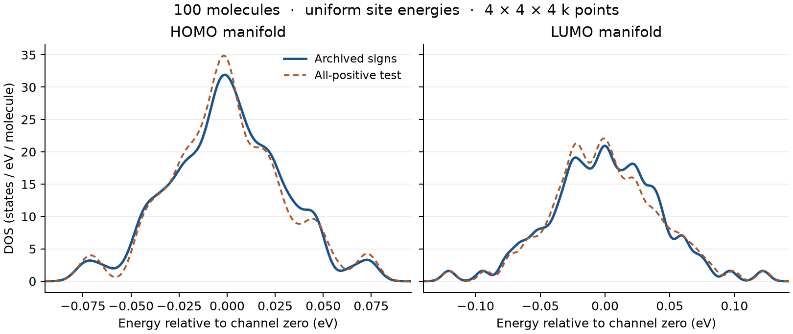

# e_006 整盒的 HOMO 与 LUMO 有效模型谱

同一帧的 100 个分子、550 对二聚体和周期镜像取自已公开的 e_006 档案。每个分子在 HOMO、LUMO 两个通道中各提供一个正交空间轨道。将归档的 VH、VL 从 meV 换算为 eV，分别作为电子 Hamiltonian 的有符号非对角元。默认两条模型各自令全部位点能为零，用于观察分子间耦合造成的展宽。两个零点独立，因此此例只能给出各前线流形内部的谱形和带宽。两条曲线之间的绝对能级差和材料带隙均未测得。[原始耦合与镜像](../e_006_ether_12-17_0/rates_and_geometry.csv) · [几何与来源核验](../e_006_ether_12-17_0/README.md)



| 每通道指标 | HOMO | LUMO |
|---|---:|---:|
| 4×4×4 网格采到的带宽 | 150.684 meV | 242.533 meV |
| Gaussian DOS 积分 | 2.000000 态/分子 | 2.000000 态/分子 |
| 谱形总变差，Γ → 2×2×2 | 0.002964 | 0.006230 |
| 谱形总变差，2×2×2 → 4×4×4 | 0.0000188 | 0.0003381 |
| 所有关联边按同一个位点符号变换后的最大能级差 | 3.33 × 10⁻¹⁶ eV | 4.58 × 10⁻¹⁶ eV |
| 所有耦合逐边取绝对值后的最大能级差 | 7.94 meV | 7.33 meV |

4×4×4 使用 64 个等权波矢和 σ = 5 meV 的 Gaussian 展宽。每个通道各有 100 个空间态，含自旋简并的积分为每个模拟盒 200 态。LUMO 通道同样计算可用态数，未乘电子占据。总变差按两条各自归一化为 1 的谱的绝对差积分再除以 2，范围为 0 至 1。程序还对每个 k 点核对谱的一阶和二阶矩。k 网格细化只检验这个给定模拟盒、展宽和 Hamiltonian 的数值采样。[HOMO 光滑谱](homo.csv) · [LUMO 光滑谱](lumo.csv) · [完整核验数值](report.json)

## 复算

在仓库根目录运行以下命令。脚本只读取仓库中已归档的 sites.csv、rates_and_geometry.csv 和 input_audit.json。它检查镜像平移后的位点间位移是否和原始表一致，再生成控制文件并实际调用十次 `wren-dos`。原盒为正交立方盒，边长 45.7679 Å。波矢采用倒格分数坐标，镜像向量采用晶格整数坐标。

```bash
uv run --locked --extra dos python runs/wren_effective_dos_2026-11-23/reproduce.py
```

结果位于 `build/e006-frontier-dos`。可用 `--output` 指向新的目录。`work/homo-signed-k4/dos.toml` 等文件可直接传给 `wren-dos`。`work/*/results/spectra.json` 保留逐 k 点本征值。两个压缩后的 CSV 含相对能量与四列 DOS，依次对应有符号 Γ、2³、4³ 和逐边取绝对值的 4³ 对照。附图可用 `uv run --with matplotlib --extra dos python runs/wren_effective_dos_2026-11-23/plot.py` 从本目录的两张表重绘。

## 换入同一帧的真实位点能

准备 UTF-8 的 CSV，列名必须为 `mol,homo_ev,lumo_ev`。每行包含一个 molecule-ID 及两个电子轨道能，单位为 eV。从 1 到 100 的编号必须各出现一次，顺序任意。使用同一帧的 100 个单体 SCF，在一致的构型提取、基组、泛函、环境和电子能量参考下计算。原 Gaussian 输入采用 B3LYP/6-31G(d)。若使用真空单体模型，可直接在 `wren-dos` 单体结果的 `spectra.json` 中按 molecule-ID 提取 `homo_ev` 和 `lumo_ev`。能量不得逐分子减去各自 HOMO。若使用电势参考或环境修正，应在两个通道和所有位点上应用同一物理约定，并说明不同层级的参数如何组合。

例如，若第 2000 帧全部单体的 Wren 计算位于 `build/e006-monomer-dos`，下面的命令可核对输出哈希、选定该帧并导出输入表。

```bash
python - <<'PYTHON'
import csv, hashlib, json
from pathlib import Path

directory = Path("build/e006-monomer-dos")
report = json.loads((directory / "result.json").read_text())
spectra = (directory / "spectra.json").read_bytes()
if report["status"] != "completed" or report["mode"] != "monomer-orbitals":
    raise ValueError("需要已完成的单体轨道计算")
if hashlib.sha256(spectra).hexdigest() != report["output_sha256"]["spectra.json"]:
    raise ValueError("能谱文件与结果摘要的哈希不匹配")
frame, = [f for f in json.loads(spectra)["frames"] if f["frame"] == 2000]
rows = sorted((int(m["id"]), m["homo_ev"], m["lumo_ev"]) for m in frame["molecules"])
if [m for m, _, _ in rows] != list(range(1, 101)):
    raise ValueError("第 2000 帧需覆盖 1 至 100 号分子，每个分子恰好一次")
with open("frame2000-frontiers.csv", "x", newline="") as output:
    writer = csv.writer(output)
    writer.writerow(["mol", "homo_ev", "lumo_ev"])
    writer.writerows(rows)
PYTHON
```

```bash
uv run --locked --extra dos python runs/wren_effective_dos_2026-11-23/reproduce.py \
  --sites frame2000-frontiers.csv \
  --site-reference "B3LYP/6-31G(d), frozen frame 2000, common molecular vacuum zero" \
  --output build/e006-frontier-with-sites
```

读取时检查表头、完整性、唯一性、有限数值、同位点 HOMO ≤ LUMO，以及调用者提供的能量参考说明。输出保存输入表的 SHA-256；实际计算方法与能量零点仍需用原始量化输出核验。少数位点的 SCF、多帧中的同一个单体、或 Hückel 初猜无法提供同一帧中 100 个单体的自洽位点能。

## 如何验证耦合相位

归档中的数值保留了正负号。原任务清单为同一分子在不同 dimer 中指定同名单体日志，支持使用共同局域轨道的模型假设。归档未包含实际运行使用的 100 份 Gaussian 检查点及其逐边绑定记录，因此本例仍将原始轨道相位一致性列为假设。

正式参数化时，为每个位点、每个轨道保存同一份带有几何、原子顺序和轨道系数的单体检查点及其哈希。投影二聚体时验证平移镜像中的 AO 和 MO 映射，保持相位一致。对简并或近简并轨道应登记整个子空间及其旋转。可选若干闭合回路用原始检查点重新计算各边，核验耦合乘积的符号。在正交单轨道模型中，将某个局域轨道统一乘以 −1，会使相连的边变号而保持所有本征值与环路乘积不变。把每条边独立取绝对值可能改变环路乘积，图和表已量化这一影响。此数值不变性检查只能检验模型组装，不能追认历史轨道的相位。若使用非正交模型，需要同一规范的原始 H、S，避免将已做成对正交化修正的耦合再次当作裸 H 元素。[片段轨道电荷输运参数](https://doi.org/10.1021/ct200388s)

本例描述一个静态形貌、归档近邻截断和选定局域基上的电子前线态。材料结论还取决于截断收敛、环境极化、分子构型与超胞的独立采样，以及所选电子结构层级。空穴形成能、电子亲和能和体相准粒子能谱需要各自对应的物理模型。
