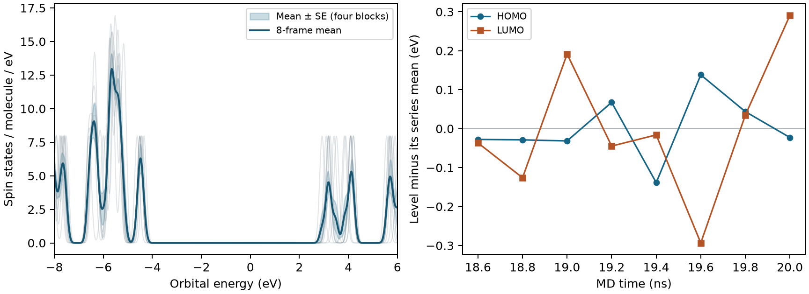

# 真实 MD 构象的单分子 DOS 采样

同一个 86 原子分子取自 GROMACS 轨迹的第 1860、1880、1900、1920、1940、1960、1980、2000 帧，帧编号从 0 开始。统计覆盖 18.6–20.0 ns，采样间隔为 200 ps。TPR 记录 300 K 的 V-rescale 恒温、各向同性 C-rescale 恒压和 2 fs 时间步，未开启退火程序。按 TPR 中的成键连接重构完整分子，核对 GRO 与 TPR 的原子顺序，在真空中对每个构象做中性闭壳层 RHF/STO-3G 单点计算。密度拟合使用 Weigend 辅助基，能量收敛阈值为 $10^{-7}$ Hartree。

每帧保留全部 302 个空间轨道和原始占据数。两个自旋态给每个空间轨道赋予权重 2，八帧等权。谱线按 σ = 0.10 eV 的高斯核展宽，能量轴使用孤立分子的共同真空参考，保留 HOMO、LUMO 的构象位移。正的 RHF 虚轨道能量仅描述所选有限基组中的轨道解，电子亲和势需要独立定义的总能量差。

1860 至 1920 帧用各 2 线程的两批 CPU 计算完成。1940 和 1960 帧首次计算在 SCF 迭代中被外部中断，随后使用相同的物理参数、单进程 8 线程重新计算。汇总仅接收校验过的收敛检查点。

## 实测结果

| 观测量 | 8 帧均值（eV） | 8 帧总体标准差（eV） | 均值的分块标准误（2 帧/块，eV） |
| --- | ---: | ---: | ---: |
| HOMO | −4.48081 | 0.07737 | 0.01013 |
| LUMO | 3.22003 | 0.16884 | 0.07212 |
| 分子轨道能隙 | 7.70084 | 0.21551 | 0.06640 |

每帧全谱积分均为 604 个自旋态。下图左侧单独显示 −8 至 6 eV 的前线能区，阴影给出四个块估计的均值标准误。右侧各轨道减去自身八帧均值，显示随构象变化的位移。Wren 的 DOS 工作流输出与这份独立汇总逐能量点核对，平均 DOS 和两帧分块标准误的最大差均为零。



## 检查与复算

- `orbital-levels.json` 保存实际帧号、时间、完整轨道谱、检查点哈希、输入文件哈希和使用的量化设置。1980、2000 帧复用了此前已收敛的同方法检查点。每帧均独立核对坐标、原子顺序、占据和计算状态。再与这两帧的独立 4 线程复算对照，HOMO 与 LUMO 的最大绝对差为 $2.39\times10^{-12}$ eV。[交叉检查记录](../wren_dos_projections_2026-11-23/md-element-pdos.json)
- `frontier-orbitals.csv` 逐帧列出 HOMO、LUMO 及轨道能隙。 `frontier-dos.csv` 保存 −8 至 6 eV 网格上的平均 DOS 和分块标准误，`ensemble-report.json` 记录谱积分、轨道波动和分块诊断。
- `analyze.py` 只需要已保存的能级即可重做统计。可加 `--plot` 绘制每帧和平均 DOS 及前线轨道波动。要从原始 MD 重新算能级，可使用 `recompute.py`，将三个输入指向自己的本地文件，参数文件身份由 SHA-256 核对。

```bash
uv run --extra dos python runs/wren_md_ensemble_2026-11-23/analyze.py \
  runs/wren_md_ensemble_2026-11-23/orbital-levels.json --output build/reanalyzed-md

uv run --extra dos --extra workflow python runs/wren_md_ensemble_2026-11-23/recompute.py \
  --tpr anneal_a.tpr --gro anneal_a_fix.gro --xtc anneal_a.xtc \
  --build build/recomputed-md --threads 2
```

## 解释采样误差

将连续的 1、2、4 个采样帧分别组成一个不重叠块，得到 8、4、2 个块。对每个能量网格点和前线轨道能量，按各块平均值的样本标准差除以块数的平方根计算条件标准误。块长为 4 帧时仅剩一个方差自由度。这组数据可检查观测值对分块方式的敏感程度，无法证明误差平台、热平衡或块间独立性。[Flyvbjerg 与 Petersen，1989](https://doi.org/10.1063/1.457480)

这项计算只包含一个分子的时间构象波动。材料中不同分子的静态分布、邻居的静电和极化以及分子间电子杂化均需要额外的数据与模型。对无序有机半导体的原子级研究可通过空间系综和时间序列分别解析位点能波动，还需在定义输运能量时考虑环境响应。[无定形有机半导体的静态和动态能量无序](https://doi.org/10.1021/acs.jpcc.0c11219)、[无序有机半导体的微观输运模拟](https://doi.org/10.1021/ct200388s)

恒温目标本身无法证明分子的缓慢构象自由度已经充分弛豫。[Chodera，2016](https://doi.org/10.1021/acs.jctc.5b00784)
